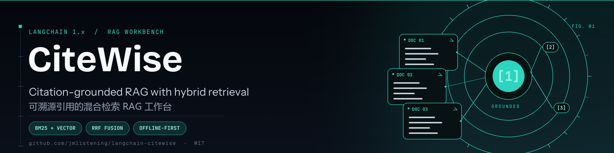
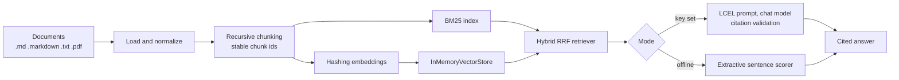

# CiteWise

<p align="center">
  
</p>

[简体中文](README.zh-CN.md)

[](https://github.com/jmlistening/langchain-citewise/actions/workflows/ci.yml)
[](LICENSE)
[](https://www.python.org/downloads/)
[](#quickstart)

**Citation-grounded RAG over your documents - modern LangChain LCEL, hybrid retrieval, offline-first demos.**

- Hybrid retrieval: BM25 and vector search are fused with reciprocal rank fusion (RRF).
- Grounded answers: offline extractive answers append a `[n]` citation to every selected sentence; online answers are prompted to cite every claim, and citation numbers are validated against the retrieved passages (answers with no citations and invalid numbers are reported as warnings).
- No-key demo: the default hashing embeddings and the extractive answerer work fully offline.

## Why this project

Most RAG examples stop at "embed, retrieve, call a model". CiteWise is a small but complete tool: it ingests a folder, builds a local index, retrieves with two complementary rankers, and produces answers whose sources you can check. It is also honest about its limits. The default embeddings are lexical feature hashing, not a semantic model, and the offline answerer extracts sentences instead of generating prose. That makes the project useful as a reference implementation and as a demo you can run on a fresh machine without an API key.

The sample corpus describes a fictional observatory. Its facts are invented for this demo and are not copied from any real source.

## Quickstart

```bash
git clone https://github.com/jmlistening/langchain-citewise.git
cd langchain-citewise
uv sync --extra pdf
uv run citewise ingest examples/corpus
uv run citewise ask "What is the primary mirror made of and how is it cleaned?" --offline
```

Real output from a run of this repository:

```text
$ uv run citewise ingest examples/corpus
Indexed 19 chunks from 4 files into .citewise
Embedding: hashing (dim 512)
Chunks:    19
Next:      citewise ask "your question" --offline

$ uv run citewise ask "What is the primary mirror made of and how is it cleaned?" --offline
+------------------------- Offline extractive answer -------------------------+
| Cleaning the mirror is a careful process. [1] The primary mirror is made of |
| 36 borosilicate glass segments, and every 18 months the observatory cleans  |
| them with carbon dioxide snow, often written as CO2 snow. [1] The           |
| observatory does not use liquid cleaners on the primary mirror. [1]         |
+-----------------------------------------------------------------------------+
Sources
[1] telescope.md - The Meridian Telescope  (rrf 0.0328)
    Cleaning the mirror is a careful process. The primary mirror is made o...
```

The runtime index lives in `.citewise/` and is gitignored. Re-run `ingest` whenever the corpus changes.

## Online models

CiteWise speaks the OpenAI-compatible chat API through `ChatOpenAI`. When `CITEWISE_API_KEY` or `OPENAI_API_KEY` is set, `ask` and `chat` use an LCEL chain `prompt | llm | StrOutputParser()`. Without a key they print a short notice and fall back to offline extractive mode, so the quickstart never needs a key.

Online mode and `--embeddings openai` require the optional extra: `uv sync --extra openai` (or `uv sync --extra dev --extra openai --extra pdf` for development).

| Variable | Default | Purpose |
| --- | --- | --- |
| `CITEWISE_API_KEY` or `OPENAI_API_KEY` | unset | API key; `CITEWISE_API_KEY` wins when both are set |
| `CITEWISE_BASE_URL` | unset | Base URL for an OpenAI-compatible endpoint |
| `CITEWISE_MODEL` | `gpt-4o-mini` | Chat model name |
| `CITEWISE_EMBEDDING_MODEL` | `text-embedding-3-small` | Embedding model, only for `--embeddings openai` |

OpenAI:

```bash
export CITEWISE_API_KEY="<your-key>"   # or put it in .env
uv run citewise ask "What happens during the winter closure?"
```

DeepSeek-style OpenAI-compatible endpoint:

```bash
export CITEWISE_API_KEY="<your-key>"
export CITEWISE_BASE_URL="https://your-openai-compatible-endpoint/v1"
export CITEWISE_MODEL="deepseek-chat"
uv run citewise ask "Which instruments are mounted on the telescope?"
```

Local Ollama:

```bash
export CITEWISE_API_KEY="ollama"   # local servers usually accept any placeholder
export CITEWISE_BASE_URL="http://localhost:11434/v1"
export CITEWISE_MODEL="llama3.2"
uv run citewise ask "What is the observatory's dark-sky policy?"
```

There is deliberately no `--api-key` flag, so keys do not end up in shell history. `--model` and `--base-url` override the environment for a single command. Never commit a real key.

A tiny built-in `.env` loader is available: it reads `.env` from the current working directory, reads only keys starting with `CITEWISE_`, does not override variables that are already set, never prints values, and `.env` is gitignored. See `.env.example`.

Online mode sends the question plus the retrieved passages to the configured endpoint. It sends nothing else and has no telemetry.

## Architecture



Ingest writes `index.json` (documents and vectors) and `manifest.json` (embedding provider, dimension, model, chunk settings, relative source list) into `--index` (default `.citewise`). Loading validates the manifest version and the embedding configuration, and refuses to mix an index with a different embedding setup.

## Evaluation

The repository ships 8 labeled questions in `examples/eval/questions.jsonl`. The command computes retrieval hit@k and MRR from source labels, and offline answer term coverage:

```bash
uv run citewise eval examples/eval/questions.jsonl
```

Actual output:

```text
hit@5 = 1.0000   MRR = 0.9375   answer term coverage = 1.0000
```

<details>
<summary>Full per-question table from the same run</summary>

```text
                          Retrieval evaluation (k=5)
+-----------------------------------------------------------------------------+
| Question                        | Hit | First rank |     RR | Term coverage |
|---------------------------------+-----+------------+--------+---------------|
| What is the primary mirror made | yes |          1 | 1.0000 |        1.0000 |
| of and how is it cleaned?       |     |            |        |               |
| What happens during the winter  | yes |          2 | 0.5000 |        1.0000 |
| closure?                        |     |            |        |               |
| How can schools join the        | yes |          1 | 1.0000 |        1.0000 |
| citizen science program?        |     |            |        |               |
| What weather conditions stop    | yes |          1 | 1.0000 |        1.0000 |
| observing?                      |     |            |        |               |
| Which instruments are mounted   | yes |          1 | 1.0000 |        1.0000 |
| on the telescope?               |     |            |        |               |
| What is the observatory's       | yes |          1 | 1.0000 |        1.0000 |
| dark-sky policy?                |     |            |        |               |
| Where is the observatory        | yes |          1 | 1.0000 |        1.0000 |
| located and how high is it?     |     |            |        |               |
| How many nights per year does   | yes |          1 | 1.0000 |        1.0000 |
| the observatory observe, and    |     |            |        |               |
| how is telescope time           |     |            |        |               |
| allocated?                      |     |            |        |               |
+-----------------------------------------------------------------------------+
hit@5 = 1.0000   MRR = 0.9375   answer term coverage = 1.0000
```

</details>

`--json` is available for machine-readable output. Diagnostics always go to stderr, so stdout stays clean.

## Privacy and security

- Local-first by default: ingestion, hashing embeddings, BM25, and offline answers make no network calls.
- No telemetry.
- Online mode sends only the question and the retrieved chunks to the endpoint you configure.
- `.env`, `.venv/`, and `.citewise/` are gitignored; the local index and source files are never uploaded to this repository.
- Source paths are stored relative to the ingest root; absolute machine paths are never persisted.
- Citation numbers are validated: out-of-range numbers are dropped from the source list with a warning. Online model text itself is not rewritten, so uncited sentences can remain; check the cited passages.

## Limitations

- The hashing embeddings are lexical, not semantic. Paraphrases with no shared words can be missed; this is the honest tradeoff for a dependency-free offline default.
- BM25 uses a small English stopword list and light suffix normalization. The default hashing embeddings are also English-centric; non-English text needs `--embeddings openai` with a suitable model.
- PDF extraction quality depends on the PDF; scanned pages without a text layer produce no text.
- There is no reranker and no query expansion.
- The offline answerer is extractive: it selects and cites sentences, and its coverage heuristic can pick a related but not perfectly targeted sentence.
- This is a compact reference tool, not a production search system.

## Project layout

```text
langchain-citewise/
├── .env.example
├── .github/workflows/ci.yml
├── .gitignore
├── assets/banner.png
├── LICENSE
├── README.md
├── README.zh-CN.md
├── examples/
│   ├── corpus/                 # 4 fictional observatory documents
│   └── eval/questions.jsonl    # 8 labeled questions
├── pyproject.toml
├── src/citewise/
│   ├── cli.py
│   ├── config.py
│   ├── corpus.py
│   ├── embeddings.py
│   ├── store.py
│   ├── retriever.py
│   ├── answer.py
│   ├── evaluation.py
│   └── output.py
├── tests/
└── uv.lock
```

## Development

```bash
uv sync --extra dev --extra openai --extra pdf
uv run --no-sync pytest -q
uv run --no-sync ruff check .
uv run --no-sync ruff format --check .
```

CI runs the same three commands on Ubuntu and Windows with Python 3.13.

## License

MIT, 2026 HappyJM. See [LICENSE](LICENSE).
