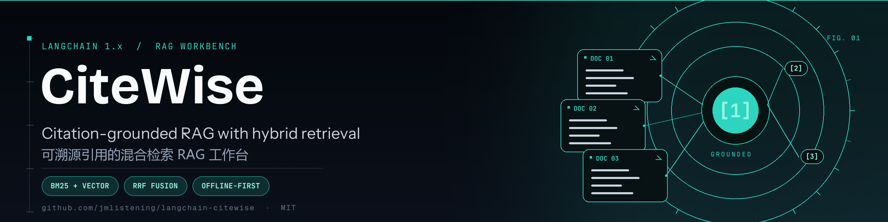
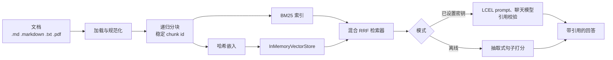

# CiteWise

<p align="center">
  
</p>

[简体中文](README.zh-CN.md) · [English](README.md)

[](https://github.com/jmlistening/langchain-citewise/actions/workflows/ci.yml)
[](LICENSE)
[](https://www.python.org/downloads/)
[](#快速开始)

**基于文档、带引用溯源的 RAG - 使用现代 LangChain LCEL、混合检索，并支持完全离线的演示。**

- 混合检索：BM25 与向量检索通过倒数排名融合（RRF）合并。
- 有据可查的回答：离线抽取式回答会为每个选中的句子追加 `[n]` 引用；在线回答会被要求逐条标注引用，且引用编号会与实际检索到的段落核对（完全没有引用的回答与越界编号会给出警告）。
- 无需密钥：默认的哈希嵌入和抽取式回答器完全离线运行。

## 为什么做这个项目

很多 RAG 示例停留在“嵌入、检索、调用模型”。CiteWise 是一个小而完整的工具：它摄取一个目录、建立本地索引、用两个互补的排序器检索，并给出可以核对来源的回答。它同样诚实地说明自己的边界。默认嵌入是词法特征哈希，不是语义模型；离线回答器做的是句子抽取，而不是生成式写作。这让项目既能作为参考实现，也能在一台没有 API 密钥的新机器上直接运行演示。

示例语料描述的是一个虚构的天文台。其中的事实是为演示编造的，不来自任何真实资料。

## 快速开始

```bash
git clone https://github.com/jmlistening/langchain-citewise.git
cd langchain-citewise
uv sync --extra pdf
uv run citewise ingest examples/corpus
uv run citewise ask "What is the primary mirror made of and how is it cleaned?" --offline
```

以下是本仓库真实运行得到的输出：

```text
$ uv run citewise ingest examples/corpus
Indexed 19 chunks from 4 files into .citewise
Embedding: hashing (dim 512)
Chunks:    19
Next:      citewise ask "your question" --offline

$ uv run citewise ask "What is the primary mirror made of and how is it cleaned?" --offline
+------------------------- Offline extractive answer -------------------------+
| Cleaning the mirror is a careful process. [1] The primary mirror is made of |
| 36 borosilicate glass segments, and every 18 months the observatory cleans  |
| them with carbon dioxide snow, often written as CO2 snow. [1] The           |
| observatory does not use liquid cleaners on the primary mirror. [1]         |
+-----------------------------------------------------------------------------+
Sources
[1] telescope.md - The Meridian Telescope  (rrf 0.0328)
    Cleaning the mirror is a careful process. The primary mirror is made o...
```

运行时索引保存在 `.citewise/`，该目录已被 git 忽略。语料变化后重新运行 `ingest` 即可。

## 在线模型

CiteWise 通过 `ChatOpenAI` 使用 OpenAI 兼容的聊天接口。设置 `CITEWISE_API_KEY` 或 `OPENAI_API_KEY` 后，`ask` 与 `chat` 会使用 LCEL 链 `prompt | llm | StrOutputParser()`。没有密钥时会打印一条简短提示并回退到离线抽取模式，因此快速开始永远不需要密钥。

在线模式与 `--embeddings openai` 需要可选依赖：`uv sync --extra openai`（开发时可用 `uv sync --extra dev --extra openai --extra pdf`）。

| 环境变量 | 默认值 | 用途 |
| --- | --- | --- |
| `CITEWISE_API_KEY` 或 `OPENAI_API_KEY` | 未设置 | API 密钥；两者都设置时优先使用 `CITEWISE_API_KEY` |
| `CITEWISE_BASE_URL` | 未设置 | OpenAI 兼容接口的基础 URL |
| `CITEWISE_MODEL` | `gpt-4o-mini` | 聊天模型名称 |
| `CITEWISE_EMBEDDING_MODEL` | `text-embedding-3-small` | 嵌入模型，仅用于 `--embeddings openai` |

OpenAI：

```bash
export CITEWISE_API_KEY="<your-key>"   # 或者写进 .env
uv run citewise ask "What happens during the winter closure?"
```

DeepSeek 风格 OpenAI 兼容接口：

```bash
export CITEWISE_API_KEY="<your-key>"
export CITEWISE_BASE_URL="https://your-openai-compatible-endpoint/v1"
export CITEWISE_MODEL="deepseek-chat"
uv run citewise ask "Which instruments are mounted on the telescope?"
```

本地 Ollama：

```bash
export CITEWISE_API_KEY="ollama"   # 本地服务通常接受任意占位值
export CITEWISE_BASE_URL="http://localhost:11434/v1"
export CITEWISE_MODEL="llama3.2"
uv run citewise ask "What is the observatory's dark-sky policy?"
```

项目故意不提供 `--api-key` 参数，避免密钥进入 shell 历史。`--model` 与 `--base-url` 只对当前命令覆盖环境变量。请勿提交真实密钥。

项目内置一个极简的 `.env` 读取器：它从当前工作目录读取 `.env`，只读取以 `CITEWISE_` 开头的键，不覆盖已经设置的环境变量，从不打印值，并且 `.env` 已被 git 忽略。可参考 `.env.example`。

在线模式只把问题与检索到的段落发送到你配置的接口，不发送其他内容，也没有遥测。

## 架构



`ingest` 会把 `index.json`（文档与向量）和 `manifest.json`（嵌入提供方、维度、模型、分块参数、相对来源列表）写入 `--index` 指定的目录（默认 `.citewise`）。加载时会校验 manifest 版本与嵌入配置，拒绝混用不同嵌入设置构建的索引。

## 评测

仓库在 `examples/eval/questions.jsonl` 中附带 8 个带标注的问题。命令会根据来源标签计算检索 hit@k 与 MRR，并用离线回答计算期望词覆盖率：

```bash
uv run citewise eval examples/eval/questions.jsonl
```

真实输出：

```text
hit@5 = 1.0000   MRR = 0.9375   answer term coverage = 1.0000
```

<details>
<summary>同一次运行的完整逐题表格</summary>

```text
                          Retrieval evaluation (k=5)
+-----------------------------------------------------------------------------+
| Question                        | Hit | First rank |     RR | Term coverage |
|---------------------------------+-----+------------+--------+---------------|
| What is the primary mirror made | yes |          1 | 1.0000 |        1.0000 |
| of and how is it cleaned?       |     |            |        |               |
| What happens during the winter  | yes |          2 | 0.5000 |        1.0000 |
| closure?                        |     |            |        |               |
| How can schools join the        | yes |          1 | 1.0000 |        1.0000 |
| citizen science program?        |     |            |        |               |
| What weather conditions stop    | yes |          1 | 1.0000 |        1.0000 |
| observing?                      |     |            |        |               |
| Which instruments are mounted   | yes |          1 | 1.0000 |        1.0000 |
| on the telescope?               |     |            |        |               |
| What is the observatory's       | yes |          1 | 1.0000 |        1.0000 |
| dark-sky policy?                |     |            |        |               |
| Where is the observatory        | yes |          1 | 1.0000 |        1.0000 |
| located and how high is it?     |     |            |        |               |
| How many nights per year does   | yes |          1 | 1.0000 |        1.0000 |
| the observatory observe, and    |     |            |        |               |
| how is telescope time           |     |            |        |               |
| allocated?                      |     |            |        |               |
+-----------------------------------------------------------------------------+
hit@5 = 1.0000   MRR = 0.9375   answer term coverage = 1.0000
```

</details>

`--json` 可输出机器可读结果。诊断信息始终写入 stderr，stdout 保持干净。

## 隐私与安全

- 默认本地优先：摄取、哈希嵌入、BM25 与离线回答都不会发起网络请求。
- 没有遥测。
- 在线模式只把问题与检索到的段落发送到你配置的接口。
- `.env`、`.venv/` 与 `.citewise/` 已被 git 忽略；本地索引与语料文件不会上传到这个仓库。
- 来源路径以相对于摄取根目录的形式保存，绝不持久化本机绝对路径。
- 引用编号会被校验：越界编号会从来源列表中移除并给出警告。在线模型生成的文本本身不会被改写，因此仍可能留下未标注引用的句子；请核对引用段落。

## 局限

- 哈希嵌入是词法方法，不是语义方法。完全没有共同词的改写可能被漏掉；这是为了无依赖、离线默认方案而做出的取舍。
- BM25 使用一份小型英文停用词表和轻量后缀归一化。默认哈希嵌入同样以英文为中心；其他语言需要使用 `--embeddings openai` 并选择合适模型。
- PDF 抽取质量取决于 PDF 本身；没有文本层的扫描页不会产生文本。
- 没有重排序器，也没有查询扩展。
- 离线回答器是抽取式的：它选择并引用句子，其覆盖度启发式可能选中相关但不完全对题的句子。
- 这是一个紧凑的参考工具，不是生产级检索系统。

## 项目结构

```text
langchain-citewise/
├── .env.example
├── .github/workflows/ci.yml
├── .gitignore
├── assets/banner.png
├── assets/demo.gif
├── LICENSE
├── README.md
├── README.zh-CN.md
├── examples/
│   ├── corpus/                 # 4 篇虚构的天文台文档
│   └── eval/questions.jsonl    # 8 个带标注的问题
├── pyproject.toml
├── src/citewise/
│   ├── cli.py
│   ├── config.py
│   ├── corpus.py
│   ├── embeddings.py
│   ├── store.py
│   ├── retriever.py
│   ├── answer.py
│   ├── evaluation.py
│   └── output.py
├── tests/
└── uv.lock
```

## 开发

```bash
uv sync --extra dev --extra openai --extra pdf
uv run --no-sync pytest -q
uv run --no-sync ruff check .
uv run --no-sync ruff format --check .
```

CI 会在 Ubuntu 与 Windows、Python 3.13 上运行同样的三条命令。

## 演示

导入示例语料，在带标注的问题上评估检索指标，再提一个跨文档问题，得到带编号引用的回答。

<p align="center">
  
</p>

<p align="center"><sub>真实离线运行录制，无需 API Key。</sub></p>

## 许可证

MIT，2026，HappyJM。详见 [LICENSE](LICENSE)。
